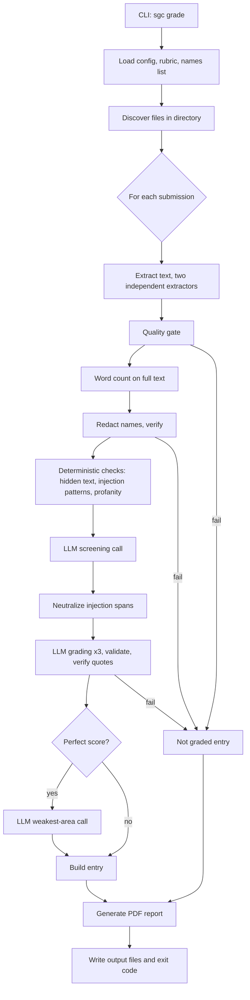

# Sim Grader Copilot: Technical Spec

Status: **Draft v3** (provider, output, configuration, request logging, and budget decisions applied). Implements [product_spec.md](product_spec.md). Requirement IDs (F#, N#, G#) refer to that document. Open questions, if any, are listed in section 17.

## 1. Summary of Decisions

| Area | Decision |
| --- | --- |
| Language | Python 3.9+ (any commonly available macOS Python), packaged with `pyproject.toml`, run as a command-line tool (`sgc`). |
| Input formats | Text-based PDF and DOCX. **No OCR in v1.** Scans and image-only pages are "Not graded". |
| Model | Hosted LLM behind a thin provider interface. Default provider: OpenAI, using the **Responses API** with `store=false` and JSON-schema structured output. Default model: `gpt-6.1-sol`, to be confirmed by the live evaluation (see 10.6). Model ID is set by flag or environment variable and recorded in every report. |
| Judgment vs. code | The model only does judgment tasks (scoring, flagging, improvement notes). Word counts, name removal, quote verification, file handling, and report generation are done by code. |
| Privacy | A single choke point: the model client accepts only a `RedactedText` object, which can be created only by the redaction step after it passes verification. |
| Reliability | Fail closed. Any problem with extraction, redaction, model output validity, or evidence verification produces "Not graded" for that submission, never a guessed grade. |
| Prompt injection | Layered defenses (section 9). The model has no tools and sees submission text only as delimited data. |
| Consistency | Each submission is scored by `--samples` independent model samples (default 1). With 3 or more, the per-category median is used and disagreement marks a category Borderline. |
| Report | Single PDF generated locally with `reportlab`. |
| Configuration | The rubric file and names file are **required inputs supplied on every run**. Nothing in code or the repository is hardcoded to a particular rubric or names list. |
| Audit trail | The **report PDF is written to the same directory as the submissions**. Logs and per-submission artifacts go in a subfolder of that directory. Original files are never modified. |

## 2. System Overview



Each submission is processed independently. An exception in one submission is caught at the pipeline boundary, converted to a "Not graded" entry, and processing continues (F12).

## 3. Project Layout

```
sim_grader_copilot/
  pyproject.toml
  README.md
  names.txt                    # sample names list (placeholder names)
  rubric/
    simulation_reflection_rubric.md
  plans/
  sgc/
    cli.py                     # argument parsing, exit codes, console summary
    config.py                  # defaults and thresholds (one place)
    pipeline.py                # per-submission orchestration
    discovery.py               # find and filter files
    rubric.py                  # parse and validate rubric
    extract/
      types.py                 # ExtractedDocument and related types
      pdf.py
      docx.py
      quality.py               # quality gate and cross-checks
    wordcount.py
    redact.py                  # names parsing, variants, redaction, verification
    checks.py                  # deterministic flag checks
    llm/
      base.py                  # LLMClient protocol
      openai_client.py
      prompts.py
      schemas.py               # pydantic models for model output
    screen.py                  # screening stage
    grade.py                   # grading and weakest-area stages
    verify.py                  # quote verification
    report.py                  # PDF generation
    runlog.py                  # run folder, manifest, logging, LLM request log (12.1)
  tests/
  examples/                    # synthetic submissions and expected outcomes
```

## 4. Command-Line Interface

```
sgc grade SUBMISSIONS_DIR \
    --rubric PATH_TO_RUBRIC \
    --names PATH_TO_NAMES_FILE \
    [--model MODEL_ID] [--samples 1] [--max-spend USD] [--dry-run]
```

Example: `sgc grade ~/Downloads/week3 --rubric rubric/simulation_reflection_rubric.md --names names.txt`

- `--rubric` and `--names` are **required on every run** and may point anywhere on disk. The files in this repository are samples. The user can edit them or swap in different files at any time.
- There is no separate output option. The report and all run files are written inside `SUBMISSIONS_DIR` (section 12).
- `--max-spend` is an optional cost ceiling (section 10.6).
- `--dry-run` runs everything up to and including redaction and writes the redacted text next to the other run files, without any model call. It also writes the exact screening request that would be sent (same format as 12.1, marked `"sent": false`). This lets the operator inspect de-identification and the prompt before anything is sent. Later requests (grading) depend on the screening result and so can only be inspected after a real run. Recommended for the first runs **[Rec]**.
- Configuration comes from flags and environment variables (`OPENAI_API_KEY`, optional `SGC_MODEL`). Secrets are never written to any output file.
- Exit codes: `0` all submissions graded; `1` report produced but one or more submissions were Not graded; `2` fatal error before processing (missing or invalid rubric, missing or empty names file, missing API key, unreadable or non-writable directory). On exit code `2` no report is produced.
- Console output: progress per file and a final summary listing each Not graded file and its reason (F11).

## 5. Rubric Loading (F37)

The rubric is parsed from Markdown into a structure at start-up:

```python
class Level(BaseModel):
    name: str           # "Exemplary"
    points: int         # 4
    description: str

class Category(BaseModel):
    name: str           # "Depth of Insight"
    max_points: int     # 4
    levels: list[Level]

class Rubric(BaseModel):
    title: str
    total_points: int
    categories: list[Category]
    source_path: str
    sha256: str
```

Expected format (as in the current file): `Total Points: N` line, `## Category (N points)` headings, and `- **Level (n):** description` bullets. Parsing is strict and fails with exit code `2` and a specific message if:

- no categories or no levels are found,
- a category has duplicate or missing point values,
- a category's top level does not equal its stated max,
- the sum of category maximums does not equal `Total Points`.

Category names, levels, and points are never hardcoded in code or prompts; prompts render the parsed rubric. This makes rubric edits safe to apply without code changes, and the sha256 recorded in the report ties each report to a rubric version.

The perfect score is defined as the maximum on every category.

## 6. Extraction and Quality Gate

### 6.1 Discovery

- Process regular files with extensions `.pdf` and `.docx` (case-insensitive) directly inside the given directory. Subdirectories are not searched.
- Ignore hidden files and Office lock files (`~$*.docx`, `.DS_Store`).
- Ignore SGC's own output: files named `sgc_report_*.pdf`. Because the report is written into the submissions directory, this prevents a previous report from being treated as a submission on a later run.
- Any other file type produces a Not graded entry ("unsupported file type") so nothing is silently skipped (F3).
- Empty directory is a fatal error (exit `2`).

### 6.2 Extracted document model

```python
class TextSpan(BaseModel):
    text: str
    visible: bool            # False for hidden/invisible text (see below)
    location: str            # "page 3", "header", "table 2", ...

class ExtractedDocument(BaseModel):
    spans: list[TextSpan]    # in reading order
    page_count: Optional[int]
    image_count: int
    extractor: str           # name and version
    warnings: list[str]
```

Two derived texts are produced from `spans`:

- `full_text`: visible text only, in reading order. This is what is word-counted and what is redacted and graded.
- `hidden_text`: all spans with `visible=False`. Handled by the deterministic checks (section 9).

### 6.3 PDF

- **Primary extractor:** `pdfplumber` (pdfminer.six). Gives per-character font size and fill color, which allows hidden-text detection.
- **Cross-check extractor:** `pypdf`. Independent implementation.
- Hidden text heuristics (best effort): fill color white or near-white, font size below 2 pt, or characters positioned outside the page box.
- Encrypted or password-protected PDFs raise a Not graded error.
- Page images are counted. Images are never sent to a model.

### 6.4 DOCX

- Walk the underlying XML with `lxml` rather than relying only on `python-docx`, so that text in all of these places is captured: body paragraphs, tables (including nested), headers and footers, footnotes and endnotes, and text boxes (`w:txbxContent`).
- Hidden text heuristics: `w:vanish` (hidden), white font color without a contrasting shading, font size at or below 2 pt.
- Deleted tracked changes (`w:del`) are excluded from `full_text` and recorded as hidden. Inserted text (`w:ins`) is included.
- Comments are not part of the student's essay: they are recorded as hidden text.
- **Cross-check:** `python-docx` paragraph and table text for the body.
- Embedded images (`word/media`) are counted.
- Files that are not valid ZIP/OOXML (including encrypted DOCX and legacy `.doc` renamed to `.docx`) raise a Not graded error.

### 6.5 Quality gate (G2, F9, F10)

A submission is **Not graded** if any of these fail. All thresholds are in `config.py` and are starting values to tune against the examples **[Rec]**.

| Check | Rule |
| --- | --- |
| Opens | Extractor completes without error. |
| Not empty | `full_text` has at least 1 word. |
| Pages with no text | For PDFs, any page with images but no extractable text, or a PDF where the proportion of text-free pages exceeds a small threshold, fails with "contains pages with no extractable text (possible scan)". Fully blank pages (no text, no images) are allowed. |
| Extractor agreement | The two extractors' word counts differ by no more than 5%, and token-set overlap is at least 95%. Otherwise "extractors disagree". |
| Garble | At least 85% of characters are letters, digits, whitespace, or common punctuation; fewer than 0.5% are U+FFFD or private-use characters; common English function words (the, and, of, to, a, in, ...) make up at least 15% of tokens. |
| Size | At most 15,000 words, to keep model calls reliable. Longer is Not graded with reason (word count flag > 1000 still applies to documents below this limit). |
| Images | A document with embedded images but otherwise readable text is graded, and the report lists a "content not reviewed: N images" note (F13). |

Because the gate is conservative and there is no OCR, a scanned file always becomes a clear Not graded entry.

## 7. Word Count (F7, F8)

- Computed in `wordcount.py` from `full_text` (visible text, all parts of the document, headings and references included) **before** redaction.
- Definition: split on whitespace; a token counts as a word if it contains at least one letter or digit. Hyphenated words count as one word. This is a deliberate, simple rule that can be changed in one function later.
- Flags: `under_500` if count < 500, `over_1000` if count > 1000. Exactly 500 and 1000 are in range. Both thresholds come from `config.py`.
- The count is shown in the report as a number plus the flag.

## 8. De-identification (5.6)

### 8.1 Names file

Plain text, UTF-8, one name per line. Blank lines and lines starting with `#` are ignored. Surrounding whitespace is trimmed. Duplicates are merged case-insensitively. An empty result is a fatal error (F23).

### 8.2 Normalization

To match across case, accents, and odd characters, the matcher works on a **folded copy** of the text where each original character maps to exactly one folded character (casefolded, accents stripped), so that match offsets map back to the original text. Before matching:

- zero-width characters, soft hyphens, and bidirectional controls are removed from the text,
- non-breaking spaces and other Unicode spaces become normal spaces,
- line-break hyphenation inside a word (`Sus-\nan`) is repaired when joining extracted lines **[Rec]**.

### 8.3 Variants (F26)

For each listed name, tokenized by whitespace:

| Name form | Variants generated |
| --- | --- |
| `Susan Lee` | `Susan Lee`, `Lee, Susan`, `Lee Susan`, `S. Lee`, `S Lee`, `Susan L.`, `Susan`, `Lee` |
| `Mary Ann Smith` | full name, `Mary Smith`, `Smith, Mary Ann`, `Smith, Mary`, initials with last name, each token alone |
| single token (`Patel`, `Dr. Patel`) | the entry as given, and without the honorific if present |
| hyphenated (`Smith-Jones`) | the full hyphenated form and each part alone |

Rules:

- Whitespace inside a variant matches `\s+` (including newlines).
- Matching is on word boundaries, case-insensitive, and an optional possessive (`'s`, `’s`, `s'`) after the match is included in the replaced span.
- A token shorter than 3 characters is **never removed on its own** (to avoid wrecking ordinary text). For a name containing such a token (e.g., `Wei Li`), SGC generates only the full-name forms (`Wei Li`, `Li, Wei`, `Li Wei`) and no standalone, initial-based, or partial variants that involve the short token.
- Longer variants are matched first so that `Susan Lee` is replaced as one unit.
- Each match is replaced with `[NAME]` (F25). The count of replacements per submission is recorded.

Names that are also ordinary words (e.g., `Hope`, `Mark`, `Will`) are always replaced; the replacement count in the report helps the instructor spot oddities (F35).

### 8.4 Verification (F31)

After redaction, an **independent check** runs: the redacted text is normalized aggressively (folded, non-letters treated as separators) and every token of 3 or more characters from every listed name is looked for as a whole token. Any survivor means the submission is **Not graded** ("name remained after redaction"). A second, whole-name check removes spaces and punctuation from both sides and searches for the concatenated full name, to catch spaced-out names such as `S u s a n  L e e`.

This check is intentionally stricter than the matcher, so it fails closed if the matcher misses a variant.

### 8.5 Type-level guard (F28, F30)

```python
class RedactedText(str):          # created only by redact.finalize()
    ...

class LLMClient(Protocol):
    def complete_structured(self, *, system: str, user: RedactedPrompt, schema: type[BaseModel]) -> BaseModel: ...
```

- `RedactedText` is produced only after verification passes. Prompts sent to the model are assembled from the rubric, fixed instructions, and `RedactedText`. A `RedactedPrompt` wrapper enforces this: it is constructed only from these parts.
- Filenames, file metadata, the names list, and document properties are never part of any prompt. Submissions are referred to by an opaque ID (`S001`, ...) recorded only in the local run folder (section 12).
- Original text (before redaction) is never written to disk. Only redacted text is persisted.

## 9. Suspicious-Content Detection and Prompt-Injection Defense

Detection happens in three layers: deterministic checks, an LLM screening call, and neutralization before grading.

### 9.1 Deterministic checks (`checks.py`)

Run on the redacted `full_text` and the hidden text:

| Check | Output |
| --- | --- |
| Hidden text | If `hidden_text` contains deliberately hidden text (white, tiny, `vanish`, or off-page), raise a **prompt injection** flag with the hidden text quoted (truncated for display), described neutrally as "text hidden from view in the document". Comments and deleted tracked changes are ordinary editing leftovers, so they raise no flag by themselves, but they are still shown to the screening model. Hidden text is **not** included in what the model grades. It is shown to the screening model (as separate, labeled data) so it can say whether it looks like instructions to a grader. |
| Injection patterns | Case-insensitive regex list for common phrasing: "ignore (all\|any\|the)? (previous\|prior\|above) (instructions\|rules)", "system prompt", "you are (now )?an? (AI\|assistant\|grader)", "(give\|assign\|award) (me\|this)? .{0,30}(full\|maximum\|perfect\|highest\|16)", "disregard the rubric", "as the grader". Matches become prompt-injection flags with the whole containing sentence quoted. The list is kept in one file and is easy to extend. |
| Profanity | Word-list match with common obfuscation handling (`f*ck`, `sh1t`, spaced letters), using an open-source list stored in the repo and reviewed by the instructor. Any hit becomes a profanity flag (any swear word, per decision). |

### 9.2 LLM screening call

A first model call that **cannot affect scores**. It receives the redacted text and any hidden text (labeled) and returns only flags:

```python
class FlagType(str, Enum):
    ai_artifact = "ai_artifact"
    fourth_wall = "fourth_wall"
    profanity = "profanity"
    unrelated_text = "unrelated_text"
    prompt_injection = "prompt_injection"
    patient_identifier = "patient_identifier"
    real_patient_care = "real_patient_care"

class Flag(BaseModel):
    type: FlagType
    quote: str            # exact text from the submission
    explanation: str      # neutral, factual, one sentence

class ScreeningResult(BaseModel):
    flags: list[Flag]
```

Guidance in the prompt follows the product spec: only blatant, indisputable AI artifacts; never speculate about AI use from style; neutral wording; quote required.

Flags from the deterministic checks and screening are merged and de-duplicated by overlapping quote.

### 9.3 Quote verification (`verify.py`)

Every flag quote must appear in the redacted text, compared after whitespace and quote-character normalization. A flag whose quote cannot be found is retried once (new call, with a note that the quote must be exact). If it still cannot be located, the flag is kept but marked "quote not located" so the instructor still sees it. Dropping it silently could hide something real.

### 9.4 Neutralization before grading (F16, F17)

For every prompt-injection flag whose quote was located, the matching span is replaced in the grading text by `[REMOVED: suspected prompt injection]`. The grading prompt also states that any instructions in the submission must be ignored. The submission is still graded (F17), and the report carries a prominent flag on that entry.

### 9.5 Defense in depth summary

1. Hidden text excluded from grading text and flagged.
2. Regex patterns catch common injections independently of the model.
3. A separate screening call that has no scoring power.
4. Injection spans removed before grading.
5. Submission text is delimited by a per-call random boundary token (e.g., `<<<SUBMISSION-7f3a9c...>>>`) so text inside cannot forge the closing delimiter; the system prompt says the content between delimiters is untrusted data.
6. Model output is structured only (JSON schema). The model has no tools, no network, and no file access.
7. Every score must cite quotes that are verified to exist in the text (section 10.3).
8. Three independent samples are compared (section 10.2).
9. Report generation never calls a model, and text from the model is escaped before rendering.

The residual risk (a subtle injection that all layers miss) is reduced, not eliminated; the instructor remains the final authority.

## 10. Grading

### 10.1 Prompt structure

System prompt (fixed, in `prompts.py`): role, the rules of objectivity and rubric adherence, instructions that submission text is untrusted data, instructions to base scores only on the rubric text, and the output schema. User prompt: the rendered rubric, then the submission between boundary tokens. No student identity or filename is present. Placeholders `[NAME]` and `[REMOVED: ...]` are explained in the system prompt.

Sampling parameters are set in `config.py` and are applied only where the chosen model supports them (reasoning models may not accept a temperature setting). The provider class handles model-specific parameters, including reasoning effort (default `medium`).

### 10.2 Output schema and validation

```python
class CategoryScore(BaseModel):
    category: str
    points: int
    rationale: str                       # brief
    evidence_quotes: list[str]           # 1 to 3 exact quotes
    borderline: bool
    alternative_points: Optional[int]    # required if borderline
    borderline_reason: Optional[str]

class GradingResult(BaseModel):
    scores: list[CategoryScore]
```

Validation (all by code, `grade.py`):

- exactly one entry per rubric category, with names matching the rubric,
- `points` is a valid level for that category (0 through 4 currently, taken from the rubric),
- `alternative_points` is adjacent to `points` when present,
- every evidence quote is verified against the redacted text (section 10.3), except for categories scored 0 where "no evidence" is the point; those require a rationale instead of quotes.

On a validation failure the call is retried (up to 2 times). If still invalid, the sample is discarded; if fewer than 2 valid samples remain, the submission is Not graded ("model output failed validation").

### 10.3 Evidence verification

Quotes must be found in the redacted text (normalized whitespace and quote characters). At least one quote per category must be located. Located quotes are shown in the report. This is the main guard against a justification that does not match the document.

### 10.4 Consistency and Borderline (F5a, N1, N2)

Each submission is graded `--samples` times (default 1, must be odd). For each category:

- the final score is the **median** of the valid samples (the lower of the two middle values if an even number of samples is valid, which happens when a sample fails validation),
- if the samples do not all agree, or if the median sample marked itself borderline, the category is marked **Borderline**, with the alternative level taken from the nearest differing sample (or the model's own `alternative_points`),
- rationale and quotes come from a sample that matches the median score.

Any Borderline category adds a note to the entry and highlights it in the report summary. The total is the sum of the final category scores.

### 10.5 Weakest-area note (F6)

Only when the total is perfect, a separate third call receives the redacted text, the rubric, and the (all-maximum) scores, and returns the category where the student went least beyond the expectations, with a brief explanation and a suggested way to go further, plus a quote. The call is separate so the model does not feel pressure to find a weakness while scoring, and the result cannot change the scores. Its quote is verified the same way. If it fails after retries, the entry says the note could not be produced; the grade is not affected.

### 10.6 Model provider, API access, cost, and retention

**API access**

- A ChatGPT subscription does **not** include API access. SGC needs an OpenAI **API key** from the OpenAI developer platform, with billing enabled. Usage is billed per token, separately from ChatGPT. Use a dedicated platform project and key for SGC.
- The key is supplied through the `OPENAI_API_KEY` environment variable and never written to disk by SGC.

**API choice**

- Use the **Responses API** (OpenAI's current primary API) via the official `openai` Python SDK, with JSON-schema structured output so responses conform to the pydantic models in 9.2 and 10.2. Code still validates every response.
- No tools, web search, file search, or stored conversations are used. Each call is self-contained and sends only text.
- All provider-specific code lives in `llm/openai_client.py` behind the `LLMClient` protocol, so another provider (including a local model) can be added without touching the rest of SGC.

**Model**

The current OpenAI catalog (checked October 2026) lists these relevant tiers:

| Model | Input / output price per 1M tokens | Use |
| --- | --- | --- |
| `gpt-6-astra` | $10 / $50 | Flagship, most capable. |
| `gpt-6.1-sol` | $2 / $10 | Near-flagship quality at lower cost. **Recommended default.** |
| `gpt-6-luna` | $0.10 / $0.50 | Cheapest, for high-volume simple tasks. |

Recommendation: default to `gpt-6.1-sol`. Grading against a rubric with evidence requirements and prompt-injection resistance benefit from a strong model, but the flagship's cost premium is probably unnecessary. Use the live evaluation (14.3) to compare all three on the synthetic set, and choose the cheapest model that meets the release gate. Model IDs and prices change, so SGC reads the model from a flag or environment variable and records it in every report.

**Cost estimate (to be measured)**

Each submission needs about 4 to 5 calls (screening, 3 grading samples, and a weakest-area call for perfect scores). Assuming roughly 3,000 input tokens per call and a few thousand output and reasoning tokens per call, that is about 15,000 input and 10,000 to 15,000 output tokens per submission:

| Model | Approx. cost per submission | Approx. cost for 20 per week |
| --- | --- | --- |
| `gpt-6.1-sol` | about $0.15 | about $3 |
| `gpt-6-astra` | about $0.75 | about $15 |
| `gpt-6-luna` | under $0.01 | under $0.20 |

These are rough, order-of-magnitude estimates. The live evaluation records actual token usage.

**Cost controls**

1. **Account-level:** set a monthly budget and usage limit of **$25 per month** (decided) on the dedicated OpenAI project. This is the hard backstop and is configured by the user in the OpenAI dashboard (setup steps in the README).
2. **In SGC:** every call's token usage is recorded in `manifest.json` and summarized in the console. A price table in `config.py` converts tokens to an estimated cost.
3. **`--max-spend USD`:** before each model call, SGC checks the running estimated cost plus the estimated input cost of the call about to be made. If the ceiling would be exceeded, it stops making calls, marks the remaining submissions Not graded ("spend limit reached"), and still writes the report for those completed. Output tokens are only known after a call, so the ceiling can be exceeded by at most one call's output.
4. **Bounded calls:** `max_output_tokens` is set on every call, and retries are capped (section 13).
5. **Tuning knobs:** `--samples` (default 1; raise it to 3 for more consistency at roughly triple the grading cost) and reasoning effort can be lowered to cut cost.
6. **Dry run:** `--dry-run` shows submission and word counts and an estimated token total before any spend.

**Data retention (what is and isn't possible)**

From OpenAI's data controls documentation:

- API data is **not used for training** by default.
- With the Responses API, response data is stored for 30 days by default ("application state"). SGC sets **`store=false`** on every call, which avoids this.
- Separately, OpenAI keeps **abuse-monitoring logs** (which can include prompts and responses) for up to 30 days by default on all API usage. There is no self-serve switch to turn this off. Excluding customer content from these logs requires **Modified Abuse Monitoring** or **Zero Data Retention**, both subject to OpenAI's prior approval (via their sales team) and additional requirements. A small account may not qualify.
- Prompt caching may hold encrypted data in GPU memory for up to 24 hours; this is not configurable by SGC unless Zero Data Retention is enabled.

**Decision:** the user has accepted the default 30-day abuse-monitoring retention, so no Zero Data Retention or Modified Abuse Monitoring application is needed. What SGC does: `store=false`, de-identification of student names (section 8), no filenames or metadata sent, and no images sent. If the institution requires zero retention, options are: apply for ZDR or Modified Abuse Monitoring, use a different provider arrangement that offers it, or use a local model (with the quality tradeoffs in the product spec, section 11).

## 11. Report (5.5)

Generated with `reportlab` (platypus), using a bundled Unicode font (e.g., DejaVu Sans) so special characters from student quotes render properly. All model and student text is XML-escaped before being placed in paragraphs.

**Page 1: summary**

- Run date and time, SGC version, model ID, rubric file name and sha256, number of submissions, counts of graded / graded with flags / Not graded.
- A table, one row per file (sorted by filename): total score, per-category scores, word count, word-count flag, a "flagged" indicator, a "Borderline" indicator, and status (F19, F20).

**Then one section per submission**, labeled with the filename (F2):

1. Status (Graded, Graded with flags, Not graded).
2. For Not graded: the reason and nothing else. No score is shown anywhere for that file.
3. Total and each category score, with rationale and evidence quotes. Borderline categories show the alternative level and reason.
4. Word count and flag (under 500 / over 1000 / within range).
5. **Suspicious activity**: list of flags, each with type, quoted text, and explanation. Prompt-injection flags are displayed in a visually prominent box at the top of the entry (F17).
6. Weakest-area note, for perfect scores only.
7. De-identification summary: number of replacements.
8. Notes: content not reviewed (images), extractor warnings.

Quotes in the report come from redacted text, so they contain `[NAME]` placeholders (F29). The report contains filenames and is treated as sensitive, and it is never sent to a model (F22a).

## 12. Output Files, Logging, and Privacy (N3, N4)

SGC writes its output **into the submissions directory** the user supplied. SGC does not manage retention or cleanup; the user keeps or deletes these files as they see fit.

```
<SUBMISSIONS_DIR>/
  student_a.pdf                         # original submissions, untouched
  student_b.docx
  sgc_report_2026-10-03T141500.pdf      # the Grade Recommendation Report
  sgc_run_2026-10-03T141500/
    run.log                             # progress, warnings, errors, tracebacks
    manifest.json                       # versions, model ID, rubric hash, args (no secrets), token usage and estimated cost, timings, ID-to-filename map
    S001/
      result.json                       # extraction stats, word count, redaction counts, flags, scores
      redacted.txt                      # text as sent to the model
      llm_calls.jsonl                   # every model request and response, exact (12.1)
      llm_calls.md                      # same calls, human-readable (12.1)
    S002/
    ...
```

- The report and the run folder share a timestamp, so repeated runs never overwrite earlier ones.
- Because the report is a PDF in the same directory as the submissions, discovery skips `sgc_report_*.pdf` (6.1). The run folder is a subdirectory and subdirectories are not searched.
- SGC checks that the directory is writable before doing any work and exits with code `2` if it is not.
- Original submissions are read-only inputs and are never modified, moved, or copied.
- Un-redacted text is never written. Prompts and responses in the LLM request log contain only redacted text.
- The mapping from opaque IDs to filenames is kept only in `manifest.json`.
- The report and run folder reference filenames, so they should be treated as sensitive. This directory is outside the repository, but a `.gitignore` entry for `sgc_report_*` and `sgc_run_*` and the sample `names.txt` guards against accidental commits if a submissions directory is ever placed inside the repo **[Rec]**.

### 12.1 LLM request log

So the operator can see exactly what is submitted to the model, SGC logs **every** model request and its response. This is always on.

- **Exact payload.** The logged request is the same object that is passed to the OpenAI SDK, serialized just before the call. It is not reconstructed afterward. Nothing is sent that is not logged. A unit test with a fake client asserts that the logged request equals the request received by the client (14.1).
- **Logged before sending.** The request is written before the call is made, so a call that fails, times out, or is retried is still visible. Each retry is logged as its own entry. The log is append-only and two-phase: a `request` event is written first, then a `response` (or `error`) event with the same `call_id`. The SDK's own silent retries are turned off (`max_retries=0`) so every network attempt is logged.
- **Fields per entry** (`llm_calls.jsonl`, one JSON object per line):
  - `call_id`, `submission_id` (`S001`), `stage` (`screening`, `grading`, `weakest_area`), `attempt` (validation attempt), `network_attempt`, `timestamp`
  - `sent` (false only for `--dry-run` entries)
  - `request`: model, instructions (system prompt), input (the redacted submission text and rubric), `store` (always `false`), `max_output_tokens`, reasoning effort, and the JSON schema for structured output
  - `response`: raw output text, parsed result or validation error, response ID, status
  - `usage` (input, output, reasoning tokens), estimated cost, and latency
- **Readable view.** `llm_calls.md` renders the same calls in order with the prompts and responses printed as plain text (real line breaks instead of escaped `\n`), so they can be read in any editor.
- **Never logged:** the API key or request headers, and any un-redacted text. Because the request is built only from `RedactedPrompt` objects (section 8), the log can only contain redacted text.
- The manifest records the total number of calls, tokens, and estimated cost, and the console summary prints the path to the run folder.

## 13. Error Handling

| Condition | Result |
| --- | --- |
| Rubric invalid, names file missing or empty, no API key, no files | Exit `2`, no report. |
| Unsupported file type, corrupt file, encrypted file | Not graded with reason. |
| Quality gate failure | Not graded with reason. |
| Name remains after redaction | Not graded with reason. |
| Model API error (timeout, rate limit, 5xx) | Retry with exponential backoff (up to 5 attempts). If still failing, Not graded ("model unavailable"). |
| Invalid structured output or unverifiable evidence | Retry (section 10.2); then Not graded. |
| Unexpected exception | Caught at the submission boundary, full traceback to `run.log`, Not graded ("internal error"). |

Principle: a Not graded entry never contains a score, and the console and report both say why (F11).

## 14. Testing and Evaluation

No instructor-graded examples will be provided, so evaluation uses synthetic data we write and instructor spot-checks.

### 14.1 Unit tests (no network)

- Rubric parser: valid file; each failure mode.
- Extraction: generated PDFs and DOCX covering tables, headers/footers, text boxes, footnotes, multiple columns, hidden/white text, encrypted file, corrupt file, scan-like PDF (image only).
- Quality gate thresholds.
- Word count: boundary cases (499, 500, 1000, 1001), hyphens, numbers, punctuation-only tokens.
- Redaction: every variant in 8.3, case, accents, possessives, line breaks, hyphenation, spaced-out names, names inside larger words (`Leeds` must not match `Lee`), names that are common words, and the verification step failing closed.
- Type guard: attempts to send non-redacted text to the client fail.
- Request log: the logged request equals the request received by a fake client; a failed call and each retry are logged; the API key never appears in any log file; `--dry-run` logs the screening request with `sent: false`.
- Deterministic checks: injection patterns and profanity with obfuscations.
- Validation and median logic using a **fake LLM client** returning scripted outputs, including invalid outputs, hallucinated quotes, and disagreeing samples.
- Report rendering: special characters and very long quotes, Not graded entries show no score.

### 14.2 Evaluation set (`examples/`)

Synthetic submissions with an `expected.yaml` (expected flags, approximate score ranges per category, expected Not graded reasons):

- strong, average, weak, and off-topic reflections,
- a near-perfect reflection (checks the weakest-area note),
- each flag type, including blatant AI artifacts, fourth-wall breaks, profanity, patient identifiers, and real patient care claims,
- injection attempts: visible, hidden (white text, `w:vanish`), and subtle phrasing,
- word counts below 500, above 1000, and exactly at the boundaries,
- names in various formats matching a test names list,
- corrupt, encrypted, and scanned files.

### 14.3 Live model evaluation (marked slow, requires API key)

- Run the evaluation set and check expected flags and score ranges.
- Run each file 5 times to measure score variability; track the Borderline rate.
- Injection resistance: submissions with injections must not score meaningfully higher than the same submission without them.
- Report precision and recall for flags; false positives are reviewed manually.
- Re-run whenever the rubric, prompts, model ID, or thresholds change.
- Compare `gpt-6.1-sol`, `gpt-6-astra`, and `gpt-6-luna` and record token usage and cost per submission, then choose the cheapest model that meets the release gate (14.4).

### 14.4 Release gate

Before relying on SGC for real grading:

- all unit tests pass,
- redaction tests have zero misses,
- all unreadable-file cases are Not graded,
- all seeded flags in the evaluation set are detected,
- instructor spot-checks the first several real batches against the report's evidence quotes.

## 15. Dependencies

| Purpose | Package |
| --- | --- |
| CLI | `typer` |
| PDF extraction | `pdfplumber`, `pypdf` |
| DOCX extraction | `python-docx`, `lxml` |
| Model schema validation | `pydantic` |
| LLM provider | `openai` |
| Report | `reportlab` |
| Tests | `pytest`, `pyyaml` |

`PyMuPDF` is avoided because of its AGPL license; the chosen libraries are permissively licensed. Dependencies are pinned by a lock file.

## 16. Implementation Plan

1. Project skeleton, config, rubric parser, CLI shell.
2. Extraction (PDF, DOCX), quality gate, word count, with tests and generated fixtures.
3. Redaction, verification, type guard, `--dry-run`.
4. LLM client, prompts, screening, deterministic checks.
5. Grading, validation, quote verification, median logic, weakest-area call.
6. Report generation and run folder.
7. Evaluation set and live evaluation; tune thresholds and prompts.
8. README run instructions for the operator.

## 17. Open Questions

None. Resolved:

- **Q1.** No OpenAI API key or billing exists yet. The README includes setup steps.
- **Q2.** Monthly spend ceiling is $25, set as the OpenAI project budget.
- **Q3.** 30-day abuse-monitoring log retention is acceptable. Zero Data Retention is not being pursued.
